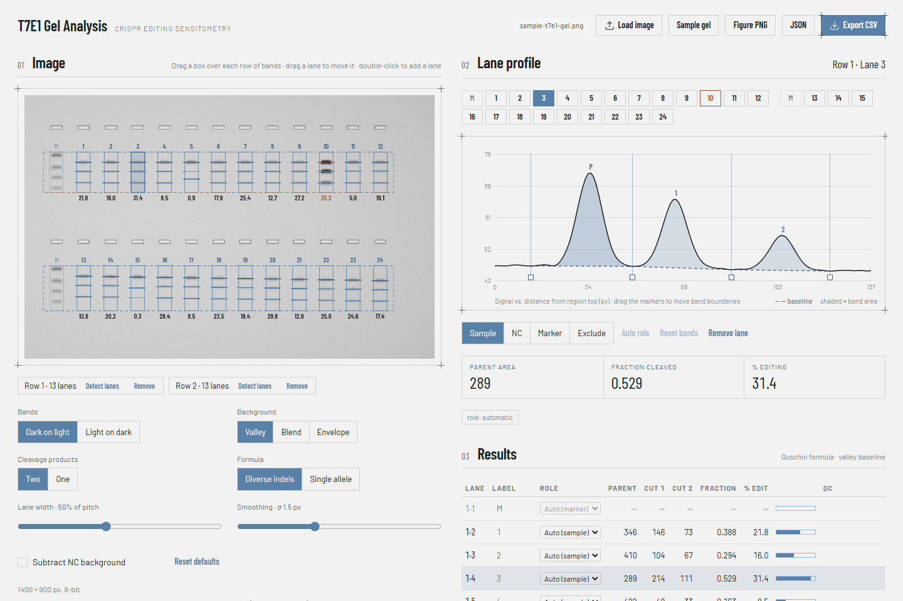
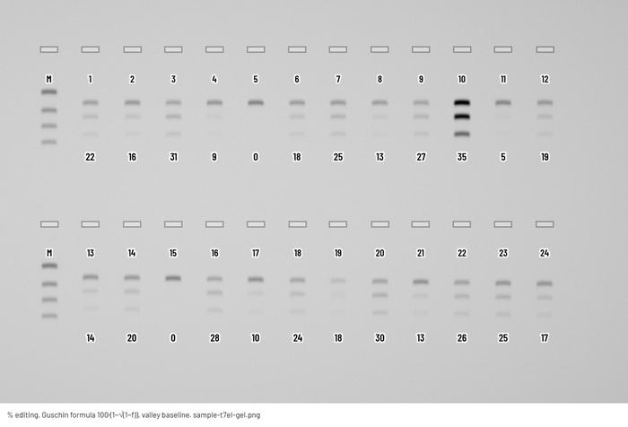

# T7E1 Gel Analysis

Densitometry for T7 endonuclease I (T7E1) mismatch-cleavage assays. Load a photo of the gel, mark each row of bands, and the app measures the parent band and both cleavage products in every lane and reports % CRISPR editing. It is a single static page in plain HTML, CSS and JavaScript, so images never leave your computer.

**Open the app: <https://dissimilis.github.io/t7eI-assay-gel-analysis/>**



## Quick start

1. Open the app and press **Load image**, or drop a PNG, JPEG or TIFF onto the image area. Pasting from the clipboard works too.
2. Drag a box over one row of bands. Include the parent band and both cleavage products with a little background above and below, and leave the wells out. The app finds the loaded lanes, recognises the ladder and skips empty wells. Repeat for every row of the gel.
3. Check the results table and the lane profile. If a lane picked the wrong band, **click the peak on the profile**: a small menu lets you remove that band (its area is then left out and it is never taken as a product) or use it as the parent, product 1 or product 2. **Edit bands** lists every band of the lane with its role, for keyboard and touch use. **Undo** steps back one band change; **Reset bands** clears all band changes of the lane. Remove lanes you don't need (**Remove lane** or Delete) and give lanes your own labels. Every setting has an ⓘ button that explains what it does.
4. Export the numbers as an **Excel workbook** (results plus a sheet with the settings used), as **CSV**, or as an annotated **Figure PNG** with % editing under every lane.

**Sample gel** loads a synthetic gel with known values, so you can try every control without your own data.



## How lanes are measured

The formula is the one from Guschin et al. (2010), also printed in the NEB T7E1 protocol:

```
fraction cleaved  f = (b + c) / (a + b + c)
% editing         = 100 × (1 − √(1 − f))
```

Here *a* is the uncut parent band and *b* and *c* are the two cleavage products. The square root comes from random reannealing of the PCR product. If a share *p* of the alleles carries an indel and the indels differ from each other, only wild-type strands pair perfectly, so the uncut share is (1 − p)² and p = 1 − √(1 − f).

The pipeline for each row:

- **Lanes.** The lane pitch comes from the autocorrelation of the row's column profile. Lane centres are the half-maximum midpoints of the peaks above a rolling-ball background. Empty wells produce no peak and are skipped.
- **Profiles.** Each lane is a vertical strip, half the lane pitch wide by default. Its mean signal per pixel row is smoothed with a Gaussian (σ 1.5 px).
- **Bands.** The parent band is the uppermost strong peak; above about 37% editing the larger cleavage product is brighter than the parent, so the strongest peak is not always the parent. In rows with three or more sample lanes, the cleavage products are located at offsets shared by the lanes, measured from each lane's own parent band. Rows can mix amplicons: lanes whose two strongest lower bands agree form a group, each group of two or more lanes gives a product pattern, and every lane takes the pattern and parent that explain its bands best. Above about 65% editing the parent can be fainter than the cut used to find it; when the row then finds too few products and most lanes show a faint band above, the products are located again from that band. A product only has to stand three times above the profile noise, so faint products next to a strong parent are found. Tilted rows and slight smiling therefore work, and a faint product is still found where its brighter neighbours put it. In smaller rows each lane uses its own strongest products (two, or one in *One* mode).
- **Background.** By default a straight line joins the valleys on either side of each band (*Valley*), which is how ImageJ Gel Analyzer is used by hand. *Envelope* draws one line under the whole lane. *Blend* starts from the valley line and moves it towards the envelope where smear lifts the valleys between bands.
- **Areas.** Each band's area is the profile summed above the baseline between its two boundaries. You can drag the boundary markers on the profile plot; the lane is then marked *edited*. A band removed by hand next to the measured bands (above the parent, between the products or just below the last one) is modelled as a Gaussian peak and subtracted before its neighbours are measured, so its tails do not lift their baselines. A removal only changes its own lane.
- **Ladders.** Ladders sit at the ends of a row, so only the first or last lane is marked as a marker: when it has four or more strong bands, or strong bands that match neither the parent nor the product positions. An interior lane like that, or an end lane whose bands fit one of the row's product patterns, is measured as a sample, with a warning or with product positions of its own. Markers take no part in finding the product positions and are not quantified.

### Parameters

| Setting | Default | Options |
|---|---|---|
| Bands | detected from the image | dark on light, light on dark |
| Background | Valley | Valley, Blend, Envelope |
| Cleavage products | Two | Two, One (when both fragments co-migrate as one band). If a fragment ran off the gel, One gives a lower bound. |
| Lane width | 50% of pitch | 20–90% |
| Smoothing | σ 1.5 px | 0–4 px |

Settings are remembered in the browser. **Reset defaults** restores them. Changing the number of cleavage products or the band polarity resets hand-moved band boundaries and band choices, and clears Undo; the app says so when there were any.

Keyboard: with a lane selected, ← and → move it (Shift for 5 px), [ and ] select the previous or next lane, and Delete removes it. **Load image** and every control are reachable with Tab; drawing a row and moving band boundaries need a pointer.

Images are limited to 40 megapixels. 16-bit TIFFs that hold 10-, 12- or 14-bit camera data are scaled by that range, so the saturation check still works; 8-bit data saved in a 16-bit file is recognised and reported as 8-bit. A lane taken for a ladder can be measured anyway with **Measure this lane**. Floating-point TIFFs are read, but clipping cannot be checked in them.

### Quality flags

| Flag | Meaning |
|---|---|
| saturated | More than 2% of the parent band core is clipped. The parent area is too small, so % editing reads high and is an upper bound. Take a shorter exposure or use the raw TIFF. |
| one product | Only one of the two cleavage products was found. Cleavage always gives both fragments, so the band found may be non-specific (a primer dimer, a second PCR product) and the value should not be trusted. |
| second product? | *One* product is selected but a second band is visible below it. Switch to *Two*. |
| P1 / P2 missing | No peak was found at the product position. The area counts as zero. Expected in uncut controls. |
| P1 / P2 faint | The product peak is less than three times the profile noise. The value depends strongly on the baseline. |
| no cleavage, no products | No cleavage product in the lane, or none anywhere in the row. |
| brighter product | Expected above about 37% editing; listed so the band assignment can be checked. |
| product saturated | A cleavage product is clipped too. The value is unreliable in either direction. |
| extra band | A band that matches neither the parent nor the products recurs across the row, for example a primer dimer; flagged in the lanes that carry it. Its signal may be counted with a neighbouring band: remove it with the band menu. |
| check bands | In most lanes of the row a product looks brighter than the parent. That happens above about 37% editing, but more often the box includes the wells or a band above the parents. Also set when a lane's product sits at a position seen in under half as many lanes as the other product, which is more often a dimer or a second PCR product than a cleavage product, and, with one product, when lanes show a further band above the row's product: the row cannot tell which of the two is the cleavage product and which a primer dimer. With two products, also when product 2 measures more than 1.3 times product 1 on both baselines (both fragments come from the same cut molecules, so the shorter one carries less dye), and when the lanes of one pattern find a product at two clearly different distances below the parent. |
| weak | The lane's strongest band is barely above background. |
| edge | A band is cut by the box edge, so part of it is missing and the baseline is lifted. Draw the box a little larger. |
| well? | The parent sits at the very top of the box, which usually means a well is inside the box. Start the box just above the parent bands. |
| unassigned band | A band inside the measured range is neither the parent nor a product, so its signal may be counted. |
| few lanes | One product and a box of three lanes or fewer, and the lane reads under 20%: the app cannot tell a cut lane from an uncut lane with a primer dimer, or an uncut lane from one cut above 75% whose parent is only a shoulder. |
| parent lower | The lane's parent sits 10 px or more below a parent position two nearby lanes share: a product taken for a faint parent at high editing, or a different amplicon. |
| band above | A band above the parent: often a faint parent at very high editing, or a well. Also set when the lane has even a faint band where nearby lanes have their parent or a band above it, or, without products, a band one product length above its parent. In boxes of one to three lanes any band above the parent that stands out of the noise counts. Check the band assignment. |
| edited | Band boundaries were moved by hand (`manual band boundaries` in the export). |
| edits dropped | Band boundaries set by hand no longer match the bands found, so the automatic ones were used. |
| boundary crosses band | A boundary set by hand lies past the peak of a band, so part of that band is counted with its neighbour. |
| bands set | Bands were removed or assigned by hand (`manual band assignment`). |
| overlap | A removed band runs into a measured band, so its share cannot be separated cleanly; check the value. |
| bands overlap | Neighbouring bands run into each other, typically faint products on the tail of a strong parent. Measured on one straight line under the lane instead, % editing differs by at least 4 points and by a factor of 1.75, or by 8 points or more; or a fit of one band shape per band, which separates touching bands, differs from the value by 3 points or more. Either way the value depends on how touching bands are split. Compare with *Envelope*. |
| smoothing | Smoothing is above the default and the lane's value moves by 2 points or more against the default smoothing: bands may have been merged. |
| other pattern | The lane follows a different product pattern than most lanes of its row (rows can mix amplicons; `product positions differ from the row`). The pattern is the app's own guess, so check the bands. |
| parent at product | The lane's parent sits one product offset below the parents of nearby lanes: at high editing the faint parent may have been missed and a product taken for it. Check the band assignment. |

The CSV export prefixes labels that start with `=`, `+`, `-` or `@` with an apostrophe, so spreadsheets do not run them as formulas. It is UTF-8 with a byte-order mark, so Excel reads accented labels correctly.

## Validation

The test suite runs the engine on the synthetic gel: two ladders and 24 lanes whose true editing follows from the reannealing model. Two of those lanes are uncut controls, one is overloaded until the parent band clips and one is underloaded. Lanes and ladders are found automatically. The 20 regular lanes come out with a mean absolute error below 0.8 points and none is off by more than 2 points. The overloaded lane is flagged as saturated and the controls read below 1%.

The engine was also compared with careful hand analysis in ImageJ of a real Invitrogen E-Gel 48 photo with 21 sample lanes. With the default *Valley* background the mean absolute difference was 0.4 points on one row and 1.8 points on the other, and the rank order of lanes was the same. The row with the larger difference has more smear between bands, and the hand analysis counted more of it as band. *Blend* brings the two rows to 0.8 and 0.6 points. The gel itself is not part of this repository; `tests/analysis.test.js` runs that comparison when a local copy is supplied through `T7E1_GEL_PGM`.

`tests/invariants.test.js` checks rules that must hold on any gel, on seeded random synthetic rows (`tests/gels.js`) with all three backgrounds and both product counts:

- **Normal gels** (bands at least six band widths apart, light noise, editing up to 70%): every sample lane reads within 2.5 points of the truth or carries a warning.
- **Hard gels cut into boxes of one to three lanes** find every lane, and no lane reads more than 10 points off without a warning.
- **Hard gels** (bands four widths apart, more noise, a sloped background, primer dimers, wells inside the box, clipped bands, editing up to 85%): no lane is more than 10 points off without a warning. Smaller errors without a warning are rare (at most 1.5% of lanes off by more than 2.5 points), mostly the *Valley* background reading low where bands nearly touch.
- **Small boxes** around one to three lanes find every lane, also on blurred, nearly noise-free images, and on normal gels read within 2.5 points or warn.
- **Rows as imagers give them** (a smile across the row, lanes of uneven brightness and spacing, primer dimers, dark or light bands): every lane is found, and no lane is more than 10 points off without a warning.
- **Hand edits** change only their own lane: the row's shared decisions and every other lane come from the same row with all edits taken out, and a second edit leaves the first edited lane as it was. Confirming the band the app already chose changes neither the value nor the warnings, and moving a boundary by hand keeps a lane's warnings.
- **Heavy smoothing** (4 px) leaves at most 1% of lanes more than 2.5 points off without a warning.
- **Lane order** changes no result, random boxes and settings never crash, and the same input always gives the same result.

An end lane with a strong extra band of its own (for example a primer dimer only in that lane) is shown as a ladder, without a value. **Measure this lane** measures it as a sample.

Boxes of one to three lanes have few other lanes to cross-check against. With one product, an uncut lane with only a primer dimer looks like a lane cut up to about 20%, and a lane cut above about 75% whose faint parent shows only as a shoulder on the product looks uncut; the image alone cannot tell them apart. In such boxes every lane reading under 20% carries the warning *few lanes*: check it against a full row or a sequencing result.

## Limitations of the assay

- T7E1 underestimates editing compared with sequencing, and it misses most single-base changes ([Vouillot et al. 2015](https://doi.org/10.1534/g3.114.015834); [Sentmanat et al. 2018](https://doi.org/10.1038/s41598-018-19441-8)).
- The formula assumes many different indels. A population dominated by one indel gives fewer heteroduplexes: with 50% wild type and 50% of a single mutant allele, f is 0.5 and the formula reports 29%. Treat results from clones and near-clonal pools as an underestimate.
- The number is the edited share of PCR product, not of cells.
- Imager JPEGs are 8-bit and often contrast-stretched, so band intensity is not strictly proportional to DNA mass. A raw 16-bit TIFF is better. The app reads uncompressed, LZW, PackBits and Deflate TIFFs.

## Run locally

No build step and no dependencies. Clone the repository and open `index.html`, or serve the folder:

```
python -m http.server 8000
```

Tests need Node.js 22 or newer (`npm test` runs the same command):

```
node --test "tests/*.test.js"
```

The suite covers the engine on synthetic gels (`analysis.test.js`), rules checked on seeded random gels (`invariants.test.js`), the TIFF reader and the XLSX writer, and the app itself in headless Chrome (`browser.test.js`, skipped when no Chrome is found; set `CHROME_PATH` to point at one). Tests on real gels run only where the images are present in `reference/`, which is kept out of the repository: `reference-gels.test.js` checks known band positions, and `reference-snapshot.test.js` compares every lane with a saved snapshot, `reference/snapshot.json`. After a change that is meant to alter results, `T7E1_UPDATE_SNAPSHOT=1 npm test` writes a new snapshot.

## Files

| Path | Contents |
|---|---|
| `index.html` | The page |
| `js/analysis.js` | Densitometry engine (no DOM; also used by the tests) |
| `js/app.js` | User interface |
| `js/tiff.js` | TIFF reader |
| `js/xlsx.js` | Small XLSX writer for the Excel export (no dependencies) |
| `js/sample.js` | Synthetic sample gel with known values |
| `css/` | Industry design system and app styles |
| `fonts/` | Barlow and Barlow Condensed (SIL Open Font License) |
| `tests/` | Node test suite, TIFF fixtures, the random-gel generator (`gels.js`) and the headless Chrome driver (`browser/`) |
| `docs/` | Screenshot and example figure for this README |

## References

- Guschin DY, Waite AJ, Katibah GE, Miller JC, Holmes MC, Rebar EJ. A rapid and general assay for monitoring endogenous gene modification. *Methods Mol Biol* 2010;649:247–256. [doi:10.1007/978-1-60761-753-2_15](https://doi.org/10.1007/978-1-60761-753-2_15)
- New England Biolabs. [Determining genome targeting efficiency using T7 Endonuclease I](https://international.neb.com/protocols/2014/08/11/determining-genome-targeting-efficiency-using-t7-endonuclease-i).
- Vouillot L, Thélie A, Pollet N. Comparison of T7E1 and Surveyor mismatch cleavage assays to detect mutations triggered by engineered nucleases. *G3* 2015;5:407–415. [doi:10.1534/g3.114.015834](https://doi.org/10.1534/g3.114.015834)
- Sentmanat MF, Peters ST, Florian CP, Connelly JP, Pruett-Miller SM. A survey of validation strategies for CRISPR-Cas9 editing. *Sci Rep* 2018;8:888. [doi:10.1038/s41598-018-19441-8](https://doi.org/10.1038/s41598-018-19441-8)

## License

MIT, see [LICENSE](LICENSE). The Barlow fonts are under the SIL Open Font License 1.1, see [fonts/OFL.txt](fonts/OFL.txt).
